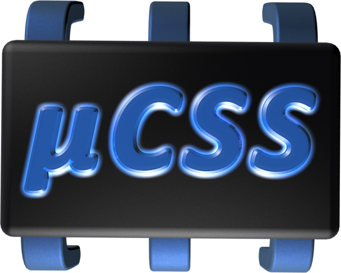
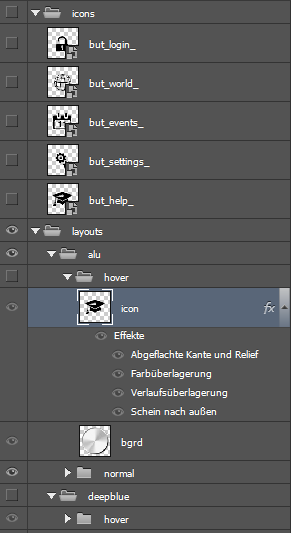
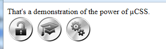

# µCSS™ V2.5.20 (microCSS)

<p align="center">
  
</p>

<p align="center">
  <a href="https://microgulp.dev">
    
  </a>
</p>

**No manual steps? Skip the editor.**

**µCSS™ is a headless image-processing and CSS build toolchain for automated Node/Gulp pipelines** — sprites, cursors, layered PSD assets, icon fonts and sound atlases. Published on npm as `gulp-mu-css`, `gulp-mu-ps`, `gulp-mu-ft` and `gulp-mu-au`.

If your image-processing workflow requires no human interaction between input and output, it probably doesn't require a desktop image editor either. µCSS™ is built for exactly these fully automated workflows.

| Question during processing | Use |
| :--- | :--- |
| Someone must judge, retouch or decide | Interactive editor or editor scripting |
| Input → output with no manual steps | µCSS™ |

Desktop editors such as Adobe Photoshop, [Affinity](https://affinity.studio/download), [Photon Studio](https://tenzen.studio/photon/) and [Photopea](https://www.photopea.com/) remain the right tools when a person needs to interact with the artwork. The dividing line is not which editor you own: it is whether a human has to stay in the loop.

| Workflow | Interactive editor | Editor scripting | µCSS™ (headless) |
| :--- | :--- | :--- | :--- |
| Manual image editing | yes | limited / requires the editor | no |
| Fully automated processing | possible | yes, inside the editor | yes |
| Desktop application required | yes | usually yes | no |
| Manual intermediate steps | possible | optional | no |
| Build-pipeline integration | indirect | possible | native focus |
| Batch processing | possible | possible | primary use case |
| CI/CD | unsuitable / limited | depends on the editor | primary use case |

When the workflow is fully automatic, there is no need to start, initialize and drive a full desktop image editor. That missing application/UI overhead is a performance consequence of the architecture — potentially substantial for large automatic batches. This repo has no comparative editor benchmarks, so no absolute “always faster” claim.

[Photon Studio](https://tenzen.studio/photon/) is a recent free desktop editor for interactive work (macOS, Windows, Linux; PSD open/save). µCSS™ has **no Photon Studio integration**. A public scripting API is not documented or wired here. If one appears later, Photon Studio plus scripting would still be *editor-based* automation (visual judgement, in-app decisions). µCSS™ remains the other class: fully automatic processing with no manual intermediate steps. The tools can overlap; they address different workflow kinds.

*English (below) · [Deutsch](#deutsch)*

Monorepo for **µCSS™ 2** and the related **µPS**, **µFT** and **µAU** modules. µCSS™ extends ordinary CSS with JavaScript in property values (`µ(...)`), build-time directives (`-µ:`), sprite atlases, cursors, a color API and PSD-based image generation — driven by a skin manifest and a Gulp build. Display names **µCSS™**, **µPS**, **µFT**, **µAU**; technical npm names `gulp-mu-*` (the µ character is awkward in package names). Version 2 is the Node successor of the 2013 Photoshop-script toolchain; the build no longer runs inside an editor.

**Authoring** layered PSD drafts (buttons, icons, …) stays in whichever editor you use — the build always goes through µPS the same way:

| Editor | Open with µPS | Configuration |
| :--- | :--- | :--- |
| **[Affinity](https://affinity.studio/download)** | `OpenDrafts(path, { app: "affinity" })` | `MU_DRAFT_APP=affinity`, optional `MU_AFFINITY_EXE` |
| **Adobe Photoshop** | `OpenDrafts(path, { app: "default" })` if `.psd` is associated, or `{ app: "<path/to/Photoshop.exe>" }` | CC license on your side; **not** required for the build |
| **[Photon Studio](https://tenzen.studio/photon/)** | `OpenDrafts(path, { app: "<path/to/Photon.exe>" })` or OS default if associated | Interactive authoring only; **no** dedicated `MU_DRAFT_APP` key |
| **[Photopea](https://www.photopea.com/)** (browser) | `await OpenPhotopeaDrafts(path)` | `--app photopea` / `MU_DRAFT_APP=photopea` (async API) |
| **OS default** | `OpenDrafts(path)` | `MU_DRAFT_APP=default` (default) |

Save as PSD — µPS reads the same layer structure regardless of editor. CLI: `node gulp-mu-ps/tools/open-drafts.mjs [--app default|affinity|photopea|<exe>] draft.psd`.

### From PSD layers to CSS sprites

| Layered draft (`icons` × `layouts` × states) | Rendered button themes (µPS) |
| :---: | :---: |
|  |  |

Layer panel from the legacy button workflow; [live demo (Buttons)](https://mamekudz.github.io/microCSS/buttons/).

## Releases (npm)

[](https://www.npmjs.com/package/gulp-mu-css)
[](https://www.npmjs.com/package/gulp-mu-ps)
[](https://www.npmjs.com/package/gulp-mu-ft)
[](https://www.npmjs.com/package/gulp-mu-au)

| Display name | npm package | Version in repo (`package.json`) |
| :--- | :--- | :--- |
| **µCSS™** | [`gulp-mu-css`](https://www.npmjs.com/package/gulp-mu-css) | **2.5.20** · [µGulp ready](https://microgulp.dev) |
| **µPS** | [`gulp-mu-ps`](https://www.npmjs.com/package/gulp-mu-ps) | **1.3.6** · [µGulp ready](https://microgulp.dev) |
| **µFT** | [`gulp-mu-ft`](https://www.npmjs.com/package/gulp-mu-ft) | **0.2.0** · [µGulp ready](https://microgulp.dev) |
| **µAU** | [`gulp-mu-au`](https://www.npmjs.com/package/gulp-mu-au) | **0.1.8** · [µGulp ready](https://microgulp.dev) |

The **H1** shows the current **µCSS™** release; bump it with `gulp-mu-css/package.json` when publishing µCSS™. Badges show live npm versions; bump the table for all modules when releasing (must match each `package.json`).

## Interactive demos

Live on **GitHub Pages** (no install): **[mamekudz.github.io/microCSS](https://mamekudz.github.io/microCSS/)**

| Demo | URL | Shows |
| :--- | :--- | :--- |
| **Buttons** | […/buttons/](https://mamekudz.github.io/microCSS/buttons/) | Legacy `buttons.psd` → two themes → sprite atlas → CSS |
| **Glittery** | […/glittery/](https://mamekudz.github.io/microCSS/glittery/) | Sprite strip + `GlitterySprite` hook |
| **FlyEx** | […/flyex/](https://mamekudz.github.io/microCSS/flyex/) | DSD macros + µAU sound atlas |

Sources and build: [`demos/`](demos/) · `npx gulp demos:build`

## Documentation & npm

| Resource | Link |
| :--- | :--- |
| **µCSS™ manual (English)** | [microCSS-en.pdf](https://github.com/mamekudz/microCSS/blob/master/gulp-mu-css/docs/microCSS-en.pdf) |
| **µCSS™ manual (German)** | [microCSS-de.pdf](https://github.com/mamekudz/microCSS/blob/master/gulp-mu-css/docs/microCSS-de.pdf) |
| **Concept & migration** | [gulp-mu-css/docs/CONCEPT.md](gulp-mu-css/docs/CONCEPT.md) |
| **Interactive demos** | [GitHub Pages](https://mamekudz.github.io/microCSS/) · [Buttons](https://mamekudz.github.io/microCSS/buttons/) · [Glittery](https://mamekudz.github.io/microCSS/glittery/) · [FlyEx](https://mamekudz.github.io/microCSS/flyex/) · [source](demos/) |
| **µCSS™ on npm** | [gulp-mu-css](https://www.npmjs.com/package/gulp-mu-css) |
| **µPS on npm** | [gulp-mu-ps](https://www.npmjs.com/package/gulp-mu-ps) |
| **µFT on npm** | [gulp-mu-ft](https://www.npmjs.com/package/gulp-mu-ft) |
| **µAU on npm** | [gulp-mu-au](https://www.npmjs.com/package/gulp-mu-au) |
| **Affinity (PSD authoring)** | [affinity.studio/download](https://affinity.studio/download) — free desktop app |
| **Photon Studio (PSD authoring)** | [tenzen.studio/photon](https://tenzen.studio/photon/) — free desktop editor (macOS / Windows / Linux) |
| **Photopea (PSD authoring)** | [photopea.com](https://www.photopea.com/) — free online editor, full PSD, local processing |

## npm packages

| Display name | npm package | Version in repo | Role |
| :--- | :--- | :--- | :--- |
| **µCSS™** | [`gulp-mu-css`](https://www.npmjs.com/package/gulp-mu-css) | **2.5.20** · [µGulp ready](https://microgulp.dev) | Compiles `*.µ.css` stylesheets (sprites, cursors, color API, manifest-driven build) |
| **µPS** | [`gulp-mu-ps`](https://www.npmjs.com/package/gulp-mu-ps) | **1.3.6** · [µGulp ready](https://microgulp.dev) | Renders PNG series, sprite atlases, app icons and animation strips from layered PSD drafts |
| **µFT** | [`gulp-mu-ft`](https://www.npmjs.com/package/gulp-mu-ft) | **0.2.0** · [µGulp ready](https://microgulp.dev) | Builds icon fonts from SVG directories and packages webfonts, including modern OpenType color fonts and emoji fonts (TTF/EOT/WOFF/WOFF2 + CSS + HTML overview) |
| **µAU** | [`gulp-mu-au`](https://www.npmjs.com/package/gulp-mu-au) | **0.1.8** · [µGulp ready](https://microgulp.dev) | Builds sound atlases (combined WAV/MP3/WebA + JSON timing map) for the µCSS™ family |

Install the compiler in your project:

```bash
npm install gulp-mu-css
```

`gulp-mu-ps` is pulled in automatically as a dependency when image generation is used. See each package's [README](gulp-mu-css/README.md) for API details and the [µCSS™ manual (EN)](https://github.com/mamekudz/microCSS/blob/master/gulp-mu-css/docs/microCSS-en.pdf) / [(DE)](https://github.com/mamekudz/microCSS/blob/master/gulp-mu-css/docs/microCSS-de.pdf).

## Repository layout

```
microCSS/                          Repository root (this monorepo)
├── gulp-mu-css/                   µCSS™ 2 — stylesheet compiler
├── gulp-mu-ps/                    µPS — PSD / image rendering
├── gulp-mu-ft/                    µFT — icon font generation
├── gulp-mu-au/                    µAU — sound atlas generation
├── demos/                         Interactive marketing demos (GitHub Pages)
├── tools/                         Root build helpers (publish, manual, …)
├── gulpfile.mjs                   Gulp tasks for tests, docs and npm publish
├── i18x/gulp/                     en-US + de-DE task log / metadata dictionaries (µGulp)
├── package.json                   Private root workspace (dev dependencies only)
└── µCSS™ 1.0 (Photoshop)/          Archived µCSS™ 1 (ExtendScript + jsxlibs submodule)
    ├── µCSS/                      Runnable Photoshop script folder
    ├── jsxlibs/                   Git submodule → mamekudz/JSXLIBS
    └── README.md                  Legacy documentation
```

Concept and migration notes: `gulp-mu-css/docs/CONCEPT.md`.

## Development

Requirements: **Node ≥ 18** (µFT: **Node ≥ 20.11**), npm, Gulp 5.

```bash
git clone --recurse-submodules https://github.com/mamekudz/microCSS.git
cd microCSS
npm install
npx gulp test              # all module tests
npx gulp docs:manual       # rebuild manual PDFs (LibreOffice + GulpHelper macro)
npx gulp build:publish     # populate build/ with publish-ready bundles
```

Useful Gulp tasks: `test:microcss`, `test:microps`, `test:microft`, `test:microau`, `test:legacy-migration` (local legacy extract only), `convert:less`, `convert:vue`, `demos:build`, `publish` (npm upload; see `tools/publish.mjs`).

### Local backups (Windows)

`npm run backup:nas` mirrors this project to the existing folder `Z:\Projects\microCSS`; override the destination with `MU_NAS_BACKUP`. This uses robocopy `/MIR`: files removed locally are also removed from the destination. Use a dedicated backup folder outside the project, never its parent folder.

Source directories such as `gulp-mu-css/src/build`, Git history, private sources and a local `recovery/` archive are included. Dependencies (`node_modules`), caches (`.cache`), root `.microgulp/`, root `build/`, `dev/out/`, `gulp-mu-ps/test/out/` and `gulp-mu-ps/examples-out/` are excluded. Local `recovery/` contents are ignored by Git but included in this backup.

`npm run test:backup` checks the backup policy using isolated temporary folders; it does not access the NAS. These checks also run through `npm test`.

## µCSS™ 1 (legacy)

The 2005–2014 ExtendScript implementation lives under [`µCSS™ 1.0 (Photoshop)/`](µCSS%201.0%20(Photoshop)/). µCSS™ 1 required a licensed desktop imaging app for CSS compilation and bitmap generation; version 2 does not. For new projects, use the npm packages above. Clone with `--recurse-submodules` so `jsxlibs/` is available for the legacy script.

## License

The µCSS™ 2 modules and this monorepo tooling are published under the **MIT License**. The legacy Photoshop version retains its own license in `µCSS™ 1.0 (Photoshop)/LICENSE`; bundled jsxlibs follow the licenses noted in their respective subfolders.

---

<a id="µcss-microcss-1"></a>

## Deutsch

# µCSS™ V2.5.20 (microCSS)

<p align="center">
  
</p>

<p align="center">
  <a href="https://microgulp.dev">
    
  </a>
</p>

**Keine manuellen Schritte? Editor überspringen.**

**µCSS™ ist eine headless Bildverarbeitungs- und CSS-Build-Toolchain für automatisierte Node-/Gulp-Pipelines** — Sprites, Cursor, geschichtete PSD-Assets, Icon-Fonts und Sound-Atlanten. Auf npm als `gulp-mu-css`, `gulp-mu-ps`, `gulp-mu-ft` und `gulp-mu-au`.

Wenn die Bildverarbeitung zwischen Eingabe und Ausgabe keine Benutzerinteraktion braucht, braucht sie wahrscheinlich auch keinen Desktop-Bildeditor. µCSS™ ist genau für diese vollautomatischen Abläufe gebaut.

| Frage während der Verarbeitung | Werkzeug |
| :--- | :--- |
| Jemand muss beurteilen, ändern oder entscheiden | Interaktiver Editor bzw. Editor-Scripting |
| Input → Output ohne manuelle Schritte | µCSS™ |

Desktop-Editoren wie Adobe Photoshop, [Affinity](https://affinity.studio/download), [Photon Studio](https://tenzen.studio/photon/) und [Photopea](https://www.photopea.com/) bleiben richtig, wenn ein Mensch die Grafik bearbeiten muss. Die Trennlinie ist nicht, welchen Editor man besitzt, sondern ob ein Mensch im Ablauf bleiben muss.

| Ablauf | Interaktiver Editor | Editor-Scripting | µCSS™ (headless) |
| :--- | :--- | :--- | :--- |
| Manuelle Bildbearbeitung | ja | eingeschränkt / braucht den Editor | nein |
| Vollautomatische Verarbeitung | möglich | ja, innerhalb des Editors | ja |
| Desktop-Anwendung nötig | ja | meist ja | nein |
| Manuelle Zwischenschritte | möglich | optional | nein |
| Build-Pipeline | indirekt | möglich | nativer Schwerpunkt |
| Batch-Verarbeitung | möglich | möglich | primärer Einsatz |
| CI/CD | ungeeignet / eingeschränkt | hängt vom Editor ab | primärer Einsatz |

Wenn der Ablauf vollständig automatisch ist, muss kein vollständiger Desktop-Bildeditor gestartet, initialisiert und gesteuert werden. Der fehlende Anwendungs-/UI-Overhead ist ein Performance-Effekt der Architektur — bei großen automatischen Serien potentiell erheblich. Dieses Repo enthält keine Vergleichsbenchmarks gegen Editoren, daher keine absolute „immer schneller“-Aussage.

[Photon Studio](https://tenzen.studio/photon/) ist ein neuer kostenloser Desktop-Editor für interaktive Arbeit (macOS, Windows, Linux; PSD öffnen/speichern). µCSS™ hat **keine Photon-Studio-Integration**. Eine öffentliche Scripting-API ist hier weder dokumentiert noch angebunden. Falls eine später erscheint, bleibt Photon Studio plus Scripting *editorbasierte* Automatisierung (visuelle Beurteilung, Entscheidungen in der App). µCSS™ bleibt die andere Klasse: vollautomatische Verarbeitung ohne manuelle Zwischenschritte. Die Werkzeuge können sich überschneiden; sie adressieren unterschiedliche Ablaufarten.

Monorepo für **µCSS™ 2** und die zugehörigen Module **µPS**, **µFT** und **µAU**. µCSS™ erweitert normales CSS um JavaScript in Eigenschaftswerten (`µ(...)`), Build-Time-Direktiven (`-µ:`), Sprite-Atlanten, Cursor, eine Farb-API und PSD-basierte Bilderzeugung — gesteuert über ein Skin-Manifest und einen Gulp-Build. Anzeigenamen **µCSS™**, **µPS**, **µFT**, **µAU**; technische npm-Namen `gulp-mu-*` (das µ-Zeichen ist in Paketnamen unhandlich). Version 2 ist der Node-Nachfolger der Photoshop-Script-Toolchain von 2013; der Build läuft nicht mehr im Editor.

**Authoring** geschichteter PSD-Entwürfe (Buttons, Icons, …) bleibt im gewählten Editor — der Build läuft immer gleich über µPS:

| Editor | Öffnen mit µPS | Konfiguration |
| :--- | :--- | :--- |
| **[Affinity](https://affinity.studio/download)** | `OpenDrafts(pfad, { app: "affinity" })` | `MU_DRAFT_APP=affinity`, optional `MU_AFFINITY_EXE` |
| **Adobe Photoshop** | `OpenDrafts(pfad, { app: "default" })` wenn `.psd` verknüpft, oder `{ app: "<Pfad/Photoshop.exe>" }` | CC-Lizenz bei Ihnen; für den **Build nicht** nötig |
| **[Photon Studio](https://tenzen.studio/photon/)** | `OpenDrafts(pfad, { app: "<Pfad/Photon.exe>" })` oder OS-Standard, wenn verknüpft | Nur interaktives Authoring; **kein** eigener `MU_DRAFT_APP`-Schlüssel |
| **[Photopea](https://www.photopea.com/)** (Browser) | `await OpenPhotopeaDrafts(pfad)` | `--app photopea` / `MU_DRAFT_APP=photopea` (async) |
| **OS-Standard** | `OpenDrafts(pfad)` | `MU_DRAFT_APP=default` (Default) |

Als PSD speichern — µPS liest dieselbe Ebenenstruktur unabhängig vom Editor. CLI: `node gulp-mu-ps/tools/open-drafts.mjs [--app default|affinity|photopea|<exe>] entwurf.psd`.

### Von PSD-Ebenen zu CSS-Sprites

| Geschichteter Entwurf (`icons` × `layouts` × Zustände) | Gerenderte Button-Themes (µPS) |
| :---: | :---: |
|  |  |

Ebenenpanel aus dem Legacy-Button-Workflow; [Live-Demo (Buttons)](https://mamekudz.github.io/microCSS/buttons/).

## Veröffentlichte Versionen (npm)

[](https://www.npmjs.com/package/gulp-mu-css)
[](https://www.npmjs.com/package/gulp-mu-ps)
[](https://www.npmjs.com/package/gulp-mu-ft)
[](https://www.npmjs.com/package/gulp-mu-au)

| Anzeigename | npm-Paket | Version im Repo (`package.json`) |
| :--- | :--- | :--- |
| **µCSS™** | [`gulp-mu-css`](https://www.npmjs.com/package/gulp-mu-css) | **2.5.20** · [µGulp ready](https://microgulp.dev) |
| **µPS** | [`gulp-mu-ps`](https://www.npmjs.com/package/gulp-mu-ps) | **1.3.6** · [µGulp ready](https://microgulp.dev) |
| **µFT** | [`gulp-mu-ft`](https://www.npmjs.com/package/gulp-mu-ft) | **0.2.0** · [µGulp ready](https://microgulp.dev) |
| **µAU** | [`gulp-mu-au`](https://www.npmjs.com/package/gulp-mu-au) | **0.1.8** · [µGulp ready](https://microgulp.dev) |

Die **H1** zeigt die aktuelle **µCSS™**-Version; beim µCSS™-Release mit `gulp-mu-css/package.json` anheben. Badges = live npm; Tabelle für alle Module beim Release mit je `package.json` abgleichen.

## Interaktive Demos

Live auf **GitHub Pages** (ohne Installation): **[mamekudz.github.io/microCSS](https://mamekudz.github.io/microCSS/)**

| Demo | URL | Inhalt |
| :--- | :--- | :--- |
| **Buttons** | […/buttons/](https://mamekudz.github.io/microCSS/buttons/) | Legacy-`buttons.psd` → zwei Themes → Sprite-Atlas → CSS |
| **Glittery** | […/glittery/](https://mamekudz.github.io/microCSS/glittery/) | Sprite-Strip + `GlitterySprite`-Hook |
| **FlyEx** | […/flyex/](https://mamekudz.github.io/microCSS/flyex/) | DSD-Makros + µAU-Sound-Atlas |

Quellen und Build: [`demos/`](demos/) · `npx gulp demos:build`

## Dokumentation & npm

| Ressource | Link |
| :--- | :--- |
| **µCSS™-Handbuch (Englisch)** | [microCSS-en.pdf](https://github.com/mamekudz/microCSS/blob/master/gulp-mu-css/docs/microCSS-en.pdf) |
| **µCSS™-Handbuch (Deutsch)** | [microCSS-de.pdf](https://github.com/mamekudz/microCSS/blob/master/gulp-mu-css/docs/microCSS-de.pdf) |
| **Konzept & Migration** | [gulp-mu-css/docs/CONCEPT.md](gulp-mu-css/docs/CONCEPT.md) |
| **Interaktive Demos** | [GitHub Pages](https://mamekudz.github.io/microCSS/) · [Buttons](https://mamekudz.github.io/microCSS/buttons/) · [Glittery](https://mamekudz.github.io/microCSS/glittery/) · [FlyEx](https://mamekudz.github.io/microCSS/flyex/) · [Quellen](demos/) |
| **µCSS™ auf npm** | [gulp-mu-css](https://www.npmjs.com/package/gulp-mu-css) |
| **µPS auf npm** | [gulp-mu-ps](https://www.npmjs.com/package/gulp-mu-ps) |
| **µFT auf npm** | [gulp-mu-ft](https://www.npmjs.com/package/gulp-mu-ft) |
| **µAU auf npm** | [gulp-mu-au](https://www.npmjs.com/package/gulp-mu-au) |
| **Affinity (PSD-Authoring)** | [affinity.studio/download](https://affinity.studio/download) — kostenlose Desktop-App |
| **Photon Studio (PSD-Authoring)** | [tenzen.studio/photon](https://tenzen.studio/photon/) — kostenloser Desktop-Editor (macOS / Windows / Linux) |
| **Photopea (PSD-Authoring)** | [photopea.com](https://www.photopea.com/) — kostenloser Online-Editor, volle PSD, lokale Verarbeitung |

## npm-Pakete

| Anzeigename | npm-Paket | Version im Repo | Aufgabe |
| :--- | :--- | :--- | :--- |
| **µCSS™** | [`gulp-mu-css`](https://www.npmjs.com/package/gulp-mu-css) | **2.5.20** · [µGulp ready](https://microgulp.dev) | Kompiliert `*.µ.css`-Stylesheets (Sprites, Cursor, Farb-API, manifestgesteuerter Build) |
| **µPS** | [`gulp-mu-ps`](https://www.npmjs.com/package/gulp-mu-ps) | **1.3.6** · [µGulp ready](https://microgulp.dev) | Rendert PNG-Serien, Sprite-Atlanten, App-Icons und Animations-Strips aus geschichteten PSD-Entwürfen |
| **µFT** | [`gulp-mu-ft`](https://www.npmjs.com/package/gulp-mu-ft) | **0.2.0** · [µGulp ready](https://microgulp.dev) | Erzeugt Icon-Fonts aus SVG-Verzeichnissen und verpackt Webfonts, einschließlich moderner OpenType-Color-Fonts und Emoji-Fonts (TTF/EOT/WOFF/WOFF2 + CSS + HTML-Übersicht) |
| **µAU** | [`gulp-mu-au`](https://www.npmjs.com/package/gulp-mu-au) | **0.1.8** · [µGulp ready](https://microgulp.dev) | Erzeugt Sound-Atlanten (kombiniertes WAV/MP3/WebA + JSON-Timing-Map) für die µCSS™-Familie |

Installation des Compilers im eigenen Projekt:

```bash
npm install gulp-mu-css
```

`gulp-mu-ps` wird bei Bilderzeugung automatisch als Abhängigkeit mitinstalliert. Details stehen in den [READMEs der Pakete](gulp-mu-css/README.md); das Handbuch liegt als [PDF (EN)](https://github.com/mamekudz/microCSS/blob/master/gulp-mu-css/docs/microCSS-en.pdf) bzw. [(DE)](https://github.com/mamekudz/microCSS/blob/master/gulp-mu-css/docs/microCSS-de.pdf) bei.

## Verzeichnisstruktur

```
microCSS/                          Repository-Wurzel (dieses Monorepo)
├── gulp-mu-css/                   µCSS™ 2 — Stylesheet-Compiler
├── gulp-mu-ps/                    µPS — PSD- / Bild-Rendering
├── gulp-mu-ft/                    µFT — Icon-Font-Erzeugung
├── gulp-mu-au/                    µAU — Sound-Atlas-Erzeugung
├── demos/                         Interaktive Marketing-Demos (GitHub Pages)
├── tools/                         Root-Build-Helfer (Publish, Handbuch, …)
├── gulpfile.mjs                   Gulp-Tasks für Tests, Doku und npm-Publish
├── i18x/gulp/                     en-US + de-DE Task-Log- / Metadaten-Wörterbücher (µGulp)
├── package.json                   Privates Root-Workspace (nur Dev-Dependencies)
└── µCSS™ 1.0 (Photoshop)/          Archiviertes µCSS™ 1 (ExtendScript + jsxlibs-Submodul)
    ├── µCSS/                      Lauffähiger Photoshop-Skriptordner
    ├── jsxlibs/                   Git-Submodul → mamekudz/JSXLIBS
    └── README.md                  Legacy-Dokumentation
```

Konzept und Migrationshinweise: `gulp-mu-css/docs/CONCEPT.md`.

## Entwicklung

Voraussetzungen: **Node ≥ 18** (µFT: **Node ≥ 20.11**), npm, Gulp 5.

```bash
git clone --recurse-submodules https://github.com/mamekudz/microCSS.git
cd microCSS
npm install
npx gulp test              # alle Modul-Tests
npx gulp docs:manual       # Handbuch-PDFs neu bauen (LibreOffice + GulpHelper-Makro)
npx gulp build:publish     # build/ mit veröffentlichungsfertigen Bundles füllen
```

Nützliche Gulp-Tasks: `test:microcss`, `test:microps`, `test:microft`, `test:microau`, `test:legacy-migration` (nur mit lokalem Legacy-Extract), `convert:less`, `convert:vue`, `demos:build`, `publish` (npm-Upload; siehe `tools/publish.mjs`).

### Lokale Sicherung (Windows)

`npm run backup:nas` spiegelt dieses Projekt in den vorhandenen Ordner `Z:\Projects\microCSS`; mit `MU_NAS_BACKUP` lässt sich das Ziel ändern. Dabei wird robocopy `/MIR` verwendet: Lokal entfernte Dateien werden auch im Ziel entfernt. Deshalb einen eigenen Sicherungsordner außerhalb des Projekts verwenden, niemals dessen übergeordneten Ordner.

Quellordner wie `gulp-mu-css/src/build`, die Git-Historie, private Quellen und ein lokales `recovery/`-Archiv werden mitgesichert. Ausgeschlossen sind Abhängigkeiten (`node_modules`), Caches (`.cache`), `.microgulp/` und `build/` im Projektstamm sowie `dev/out/`, `gulp-mu-ps/test/out/` und `gulp-mu-ps/examples-out/`. Lokale Inhalte unter `recovery/` werden von Git ignoriert, aber von dieser Sicherung mitgenommen.

`npm run test:backup` prüft die Sicherungsregeln in isolierten temporären Ordnern, ohne auf das NAS zuzugreifen. Diese Prüfungen laufen auch über `npm test`.

## µCSS™ 1 (Legacy)

Die ExtendScript-Implementation von 2005–2014 liegt unter [`µCSS™ 1.0 (Photoshop)/`](µCSS%201.0%20(Photoshop)/). µCSS™ 1 brauchte eine lizenzierte Desktop-Bildbearbeitung für CSS-Kompilierung und Bitmap-Erzeugung; Version 2 nicht. Für neue Projekte die npm-Pakete oben verwenden. Beim Klonen `--recurse-submodules` setzen, damit `jsxlibs/` für das Legacy-Skript vorhanden ist.

## Lizenz

Die µCSS™-2-Module und das Monorepo-Tooling stehen unter der **MIT-Lizenz**. Die Legacy-Photoshop-Version behält ihre eigene Lizenz in `µCSS™ 1.0 (Photoshop)/LICENSE`; die eingebundenen jsxlibs folgen den in ihren Unterordnern genannten Lizenzen.
